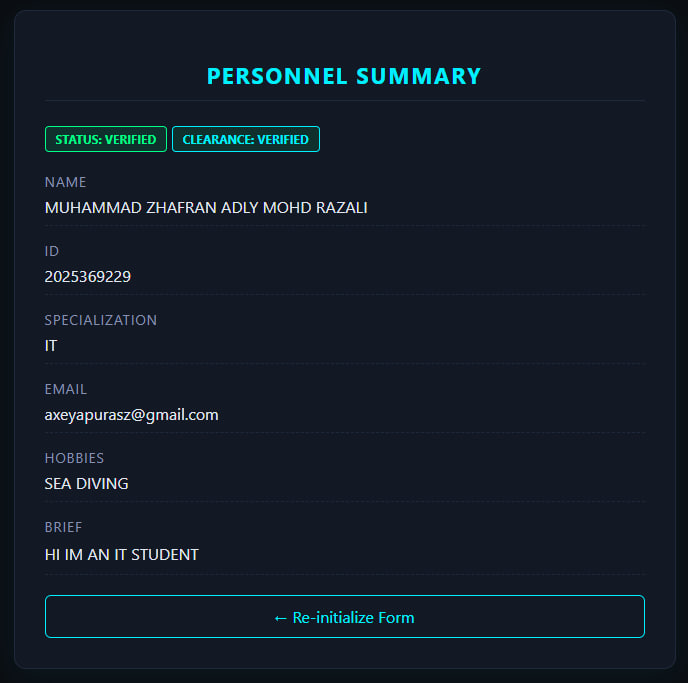

# Personal Profile Web Application

A Java EE web application built using NetBeans, GlassFish, Servlets, and JSP. It implements an MVC architecture with a secure backend sanitization layer and client-side validation.

## Architecture & Data Flow

1. **View (Input):** `index.html` collects operator details and validates inputs via `script.js`.
2. **Controller:** `ProfileServlet.java` intercepts the HTTP POST request, sanitizes inputs against XSS, and binds attributes to the request context.
3. **View (Output):** `profile.jsp` dynamically renders the profile summary using JSP Expression Language (`${...}`).
4. **Styling:** `style.css` provides a responsive, clean dashboard UI[cite: 1].

## Project Structure
CSC584-Individual-Assignment-1/
├── Web Pages/
│   ├── index.html
│   ├── profile.jsp
│   ├── script.js
│   └── style.css
└── Source Packages/
    └── ProfileServlet.java
Tech Stack
- IDE: NetBeans 8.2[cite: 1]
- Application Server: GlassFish 4.1.1[cite: 1]
- Languages: Java EE 7, HTML5, CSS3, JavaScript
How to Run
1. Open the project in NetBeans 8.2.
2. Ensure GlassFish Server 4.1.1 is active under your servers list.
3. Right-click the project root and select Run (or press F6)[cite: 1].
Security Features
- Server-Side Sanitization: Encodes special characters in ProfileServlet.java to prevent Cross-Site Scripting (XSS).
- Client-Side Validation: Verifies required fields and email formatting via script.js before submission.

Application Screenshots
Input Interface (`index.html`)

Dossier Output (`profile.jsp`)
.png)
